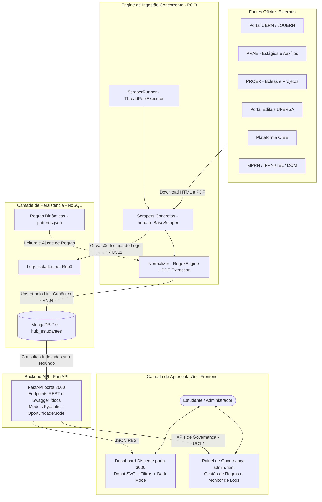

# EduScrap UERN – Plataforma de Oportunidades Acadêmicas

<div align="center">


<p align="center">
  <strong>Hub centralizado de mineração, curadoria e monitoramento de editais, bolsas, estágios e notícias acadêmicas para o ecossistema universitário potiguar.</strong>
</p>

</div>

---

## Sobre o Projeto

No ambiente universitário regional, informações vitais para a permanência e formação discente encontram-se fragmentadas em múltiplos portais institucionais desarticulados (Jornal Oficial JOUERN em PDFs volumosos, sites da PRAE e PROEX, portais de faculdades isoladas, diários municipais, portais da UFERSA e plataformas corporativas como o CIEE). Essa descentralização provoca perda crônica de prazos regulamentares e impede que estudantes tenham acesso igualitário a bolsas e estágios.

### A Solução
O **EduScrap** resolve essa dor ao atuar como um agregador e minerador automatizado:
1. **Web Scraping Paralelo Concorrente:** Robôs orientados a objetos (`BaseScraper`) orquestrados via `ThreadPoolExecutor` (`ScraperRunner`);

2. **Normalização Textual & Leitura de PDFs:** Parsing híbrido com Expressões Regulares (`RegexEngine`) e `pdfplumber`/`pdfminer` para extração de prazos, categorias e valores;
3. **Persistência NoSQL Indexada:** Cluster **MongoDB 7.0** encapsulado pela classe `MongoDatabase` com índices textuais compostos e busca instantânea;
4. **API RESTful Assíncrona:** Backend de alta performance com **FastAPI**, modelos tipados com **Pydantic** (`OportunidadeModel`), documentação Swagger interativa e latência sub-segundo (RNF01);
5. **Dashboard SPA Moderno:** Interface visual com Tema Claro/Escuro (`theme.js`), gráfico Donut interativo em SVG, seletores por curso e **Painel Administrativo de Governança Técnica**.

---

##  Funcionalidades Principais

- ⚡ **Web Scraping Concorrente Multi-Worker (`run_scrapers.py`):** Coleta paralela em múltiplas fontes com isolamento de logs individuais por robô em `logs/<fonte>.log`.

-  **Validação Temporal Automática de Prazos (RN01 a RN03):** Cálculo dinâmico comparando a data do servidor com os prazos de inscrição, gerando badges de alerta para prazos críticos ($\le$ 3 dias) e marcação de certames vencidos.
-  **Painel Analítico com Gráfico Donut (UC05):** Visualização interativa em SVG que renderiza em tempo real a proporção de editais abertos, vencendo em até 7 dias e encerrados.
-  **Filtro Inteligente por Áreas e Cursos (UC03):** Seletor dinâmico baseado em `config/course_mapping.json` contemplando 15 cursos e áreas temáticas (Tecnologia, Saúde, Humanas, Exatas, etc.).
-  **Feed Unificado e Busca Textual (UC01 / UC02 / Figura 4):** Endpoint consolidado `GET /api/oportunidades` para busca por palavra-chave, categoria, fonte e vigência.
-  **Modo Escuro (Dark Mode) Nativo (UC08):** Alternância instantânea de tema sem recarregar a página, com persistência no `localStorage` e troca de logo.
-  **Área do Estudante e Favoritos (UC06 / UC09):** Cadastro com termo de consentimento LGPD, autenticação com hash criptográfico (PBKDF2/SHA256) e gerenciamento de favoritos.
-  **Painel Administrativo de Governança Técnica (UC11 / UC12 / RF12):** Interface web (`admin.html`) para monitoramento de logs de robôs e ajuste de URLs e expressões de extração (`patterns.json`) em tempo de execução sem recompilar, com proteção contra SSRF.
-  **Portabilidade Total com Docker (RNF08 / Seção 12):** Empacotamento completo com `Dockerfile.backend`, `Dockerfile.frontend` e `docker-compose.yml`.

---

## Arquitetura do Sistema



---

## ⚡ Como Rodar o Projeto

Você pode iniciar o EduScrap de duas formas:

### Opção A: Via Docker Compose (Recomendado)

Sobe todos os serviços (MongoDB 7.0, API FastAPI e Frontend) em containers isolados:

```bash
docker compose up --build -d
```

Para verificar o status dos containers:
```bash
docker compose ps
```

Para parar os serviços:
```bash
docker compose down
```

---

### Opção B: Inicialização Local em 1 Comando (`start.sh`)

Garante a inicialização do MongoDB local, configuração dos índices de busca e execução paralela do Backend e Frontend:

```bash
./start.sh
```

> **Dica:** Você também pode utilizar o `Makefile`:
> ```bash
> make run
> ```

---

### URLs da Aplicação:

| Recurso | URL | Descrição |
| :--- | :--- | :--- |
| **Portal do Estudante** | [http://localhost:3000](http://localhost:3000) | Dashboard interativo, feed, Donut chart e modo escuro |
| **Painel de Governança** | [http://localhost:3000/admin.html](http://localhost:3000/admin.html) | Monitor de logs e editor de regras de extração (UC11/UC12) |
| **API Backend** | [http://localhost:8000](http://localhost:8000) | Servidor FastAPI sob Uvicorn |
| **Documentação Interativa (Swagger)** | [http://localhost:8000/docs](http://localhost:8000/docs) | Testador interativo de endpoints e esquemas OpenAPI |
| **Documentação Alternativa (ReDoc)** | [http://localhost:8000/redoc](http://localhost:8000/redoc) | Documentação formal da API REST |

---

## Coleta de Dados (Web Scraping Paralelo Concorrente)

O orquestrador `ScraperRunner` em `run_scrapers.py` dispara as varreduras em threads paralelas sem degradar a API:

```bash
# Executa todas as fontes em paralelo multi-worker (Recomendado):
python run_scrapers.py
# ou:
make scrape

# Executa apenas fontes específicas (ex.: PRAE e PROEX):
python run_scrapers.py prae proex

# Executa em modo sequencial:
python run_scrapers.py --serial
```

### Fontes Integradas:
| Chave | Nome da Fonte | Implementação POO | Coleção no Banco |
| :--- | :--- | :--- | :--- |
| `prae` | PRAE/UERN (Estágios e Auxílios) | `ScraperPRAE` (BaseScraper) | `vagas_estagio` |
| `proex` | PROEX/UERN (Bolsas e Projetos) | `ScraperPROEX` (BaseScraper) | `vagas_bolsa` |
| `ufersa` | UFERSA (Editais de Assistência) | `ScraperUFERSA` (BaseScraper) | `vagas_ufersa` |
| `ciee` | CIEE (Estágios Comerciais Mossoró) | `ScraperCIEEHibrido` | `vagas_ciee` |
| `portal_uern` | Portal Central UERN | Mineração textual e paginação | `vagas_portal_uern` |
| `noticias` | Notícias Tech & Inovação | Feed RSS / Mineração HTML | `vagas_noticias` |
| `cpps_ufersa` | CPPS UFERSA | Processos seletivos acadêmicos | `editais` |
| `assecom_ufersa` | ASSECOM UFERSA | Comunicados oficiais | `noticias` |
| `mprn` | MPRN | Estágios e residência jurídica | `vagas` |
| `iel_rn` | IEL/RN | Vagas corporativas e estágios | `vagas` |
| `ifrn` | IFRN | Processos seletivos e bolsas | `editais` |
| `dom_mossoro` | DOM Mossoró | Editais municipais oficiais | `editais` |

---

## Referência da API RESTful (FastAPI)

### Oportunidades & Editais
| Método | Endpoint | Parâmetros Principais | Descrição |
|:---:|:---|:---|:---|
| `GET` | `/` | — | Status da API e versão do EduScrap |
| `GET` | `/api/oportunidades` | `categoria`, `fonte`, `busca`, `apenas_vigentes`, `pagina`, `limite` | **Feed unificado e consolidado** com filtros e ordenação temporal (Figura 4) |
| `GET` | `/api/estagios` | `pagina`, `limite`, `apenas_vigentes` | Oportunidades de estágio |
| `GET` | `/api/bolsas` | `pagina`, `limite`, `apenas_vigentes` | Bolsas e auxílios acadêmicos |
| `GET` | `/api/ufersa` | `pagina`, `limite`, `apenas_vigentes` | Editais da UFERSA |
| `GET` | `/api/ciee` | `pagina`, `limite`, `apenas_vigentes` | Vagas corporativas CIEE |
| `GET` | `/api/pesquisar` | `termo` | Busca textual por Regex/Text index |
| `GET` | `/api/estatisticas`| — | Métricas de prazos e vigência para o Gráfico Donut |

### Autenticação & Favoritos (Estudante)
| Método | Endpoint | Header / Payload | Descrição |
|:---:|:---|:---|:---|
| `POST`| `/api/auth/register` | `{ nome, email, senha, matricula, curso }` | Cadastro discente com aceite de termos |
| `POST`| `/api/auth/login` | `{ email, senha }` | Autenticação e geração de token JWT |
| `GET` | `/api/auth/me` | `Bearer <token>` | Perfil do usuário autenticado |
| `GET` | `/api/favoritos` | `Bearer <token>` | Listagem de favoritos do estudante |
| `POST`| `/api/favoritos/{id}` | `Bearer <token>` | Adiciona oportunidade aos favoritos |
| `DELETE`| `/api/favoritos/{id}`| `Bearer <token>` | Remove oportunidade dos favoritos |
| `GET` | `/api/feed/personalizado`| `Bearer <token>` | Feed customizado por cursos de interesse |

### Governança Técnica, Monitoramento e Logs (UC11 / UC12)
| Método | Endpoint | Header / Payload | Descrição |
|:---:|:---|:---|:---|
| `GET` | `/api/admin/regras` | `X-API-Key` ou `Bearer <token>` | Consulta regras de extração do `patterns.json` |
| `PUT` | `/api/admin/regras` | `X-MFA-Code`, JSON com regras | Atualiza regras em tempo de execução com proteção MFA (TOTP) |
| `GET` | `/api/admin/fontes` | `X-API-Key` ou `Bearer <token>` | Lista parâmetros e fontes ativas cadastradas |
| `GET` | `/api/logs` | — | Dashboard consolidado com status, duração e itens de todos os scrapers |
| `GET` | `/api/logs/{fonte}` | — | Parser estruturado em JSON do log individual do scraper (`logs/<fonte>.log`) |
| `GET` | `/api/snapshots/{id}`| — | Download e visualização do snapshot do PDF armazenado no GridFS |
| `GET` | `/api/auth/mfa/status`| — | Consulta se o Segundo Fator de Autenticação (MFA) está ativo |
| `POST`| `/api/auth/mfa/setup` | `X-API-Key` ou `Bearer <token>` | Gera segredo Base32 e URI para app autenticador |
| `POST`| `/api/auth/mfa/ativar`| `{ codigo, secret }` | Valida código TOTP e ativa o MFA permanentemente |

---

## Deploy e Infraestrutura Multiplataforma

### Compatibilidade: Desenvolvimento (Windows) vs. Implantação (Linux Mint)

O EduScrap foi arquitetado para permitir desenvolvimento fluido em máquinas **Windows** e implantação estável em servidores ou estações **Linux Mint**:

| Recurso / Componente | Ambiente de Desenvolvimento (Windows) | Ambiente de Implantação (Linux Mint) | Comportamento / Ação Técnica |
|:---|:---:|:---:|:---|
| **Eliminação de Zombies Chrome** | `taskkill /F /IM chrome.exe` | `pkill -f chrome` | **Multiplataforma automático:** `matar_processos_chrome()` detecta `sys.platform == "win32"` e executa o utilitário nativo correspondente. |
| **Swappiness de Memória** | Gerenciado pelo `pagefile.sys` | `vm.swappiness=10` no `/etc/sysctl.conf` | `swappiness` é exclusivo do kernel Linux. No Windows, a memória virtual é tratada nativamente sem parâmetros adicionais. |
| **Agendamento de Notificações e Limpeza** | Execução direta manual ou Agendador de Tarefas (`schtasks`) | **Systemd Timers** (`.service` + `.timer`) | No Linux Mint, os timers garantem dependência estrita (`After=eduscrap-scraper.service`). No Windows, os scripts são executados via `python notify_users.py` ou `schtasks`. |
| **Docker Compose Limits** | Docker Desktop (WSL2) | Docker Engine (cgroups nativos) | No Windows, o WSL2 introduz uma leve camada de overhead. Se a máquina host possuir 8 GB de RAM, os limites de containers podem ser ajustados para 512 MB durante o desenvolvimento local. |

### 1. Limites de Recursos no Docker Compose
Para impedir que um container monopolize a memória RAM e cause travamento no sistema (OOM Killer), o `docker-compose.yml` define limites estritos e políticas de reinicialização resilientes:

- **MongoDB 7.0:** Limite de 1 GB de RAM (`deploy.resources.limits.memory: 1G`).
- **Backend FastAPI:** Limite de 1 GB de RAM (`deploy.resources.limits.memory: 1G`).
- **ScraperRunner:** Limite de 1 GB de RAM, `restart: on-failure:3` (evita restart loops em caso de OOM) e `healthcheck` ativo monitorando o processo (`pgrep -f run_scrapers.py`).
- **Frontend SPA:** Limite de 256 MB de RAM (`deploy.resources.limits.memory: 256M`).

```bash
# Inicializar todo o ecossistema com limites aplicados:
docker compose up -d --build
```

### 2. Automação e Orquestração com Systemd Timers (Exclusivo Linux Mint)
O EduScrap substitui o CRON tradicional por **Systemd Timers**, garantindo que notificações só rodam após a coleta terminar (`After=eduscrap-scraper.service`) com integração nativa ao `journalctl`:

- `eduscrap-scraper.service`: Executa a coleta paralela `run_scrapers.py`.
- `eduscrap-notify.service` e `eduscrap-notify.timer`: Script autônomo `notify_users.py` que varre editais com vencimento em até 3 dias ($\le$ 3 dias), consulta usuários interessados e dispara alertas por E-mail (SMTP) e Telegram Bot Webhook.
- `eduscrap-cleanup.service` e `eduscrap-cleanup.timer`: Script de retenção `cleanup_snapshots.py` que remove snapshots de PDFs no GridFS com mais de 12 meses (365 dias), preservando o armazenamento SSD.

```bash
# Instalação automatizada das units do systemd (apenas no Linux):
sudo ./systemd/install_systemd.sh
```

> **Nota para o Desenvolvimento no Windows:**
> Como o `systemd` é exclusivo do ecossistema Linux, durante o desenvolvimento no Windows você pode testar as notificações e limpeza executando os scripts diretamente no terminal:
> ```cmd
> python notify_users.py
> python cleanup_snapshots.py --dias 365
> ```
> Para agendamento local automatizado no Windows, use o Agendador de Tarefas (`schtasks /create /tn "EduScrapNotify" /tr "python notify_users.py" /sc daily /st 07:00`).

### 3. Preservação de Documentos com Snapshots no GridFS
Para proteger a plataforma contra a volatilidade e expiração de links nos portais institucionais externos, os scrapers armazenam os PDFs originais no **GridFS do MongoDB**:
- Gravação via `gridfs.GridFS(db).put(pdf_bytes, filename=...)`;
- Recuperação via endpoint streaming `/api/snapshots/{file_id}`;
- Purga automática após 12 meses via script `cleanup_snapshots.py`.

### 4. Acessibilidade e Contraste WCAG 2.1 AA
O frontend adota paleta de cores estritamente validada pelo **WebAIM Contrast Checker** (mínimo 4.5:1):
- Texto em fundo claro: `#B71C1C` (relação de contraste 7.0:1 contra branco).
- Badges e textos em fundo escuro: `#EF5350` (relação de contraste 4.8:1 contra `#0F172A`).
- Redundância visual: ícones de estado aliados a cores e textos explícitos (WCAG 1.4.1).

### 5. Exportação para Calendário iCalendar (.ics)
Todo edital com data limite possui o botão **"Adicionar ao Calendário"** no card, gerando arquivos `.ics` em formato padrão **RFC 5545** diretamente no navegador via `Blob`, permitindo sincronização instantânea com Google Agenda, Outlook e Apple Calendar com zero sobrecarga de RAM no backend.

---

## Testes Automatizados (Pytest)

A suíte de testes cobre 100% dos módulos do sistema, incluindo integração NoSQL, Regex, extração de PDFs, MFA (pyotp), logs REST, snapshots GridFS e testes de desempenho:

```bash
# Executar toda a suíte de testes:
pytest -v
# ou:
./venv/bin/pytest tests/ -v
```

**Resultado:** `85 passed, 0 failed` (100% de sucesso).

> **Nota:** Os testes são executados manualmente antes de cada commit. Não há pipeline de CI/CD configurado no repositório.

---

## Estrutura do Repositório

```
EduScrap/
├── backend/
│   ├── base_scraper.py           # Classe abstrata BaseScraper (RNF05 / Figura 11)
│   ├── models.py                 # Modelos Pydantic de domínio (OportunidadeModel, etc.)
│   ├── mongo_database.py         # Classe MongoDatabase para persistência NoSQL
│   ├── main.py                   # API RESTful FastAPI (MFA, Logs, Snapshots, Oportunidades)
│   ├── database_setup.py         # Criação de índices e validação de schema
│   ├── scraper_*.py              # Classes e scripts dos robôs de coleta
│   └── pdf_utils.py              # Extração de datas e snapshots via GridFS
├── frontend/
│   ├── index.html                # Interface principal do estudante (Dashboard SPA)
│   ├── admin.html                # Painel de governança técnica (UC11 / UC12 / MFA)
│   ├── login.html                # Autenticação e cadastro
│   ├── script.js                 # Lógica de filtros, .ics e consumo da API
│   ├── theme.js                  # Controle dinâmico de Modo Claro e Escuro
│   └── style.css                 # Estilização Tailwind e regras de contraste WCAG 2.1
├── systemd/
│   ├── eduscrap-scraper.service  # Unit de coleta concorrente
│   ├── eduscrap-notify.service   # Unit de notificação de prazos
│   ├── eduscrap-notify.timer     # Timer de disparo de notificações
│   ├── eduscrap-cleanup.service  # Unit de limpeza de snapshots GridFS
│   ├── eduscrap-cleanup.timer    # Timer semanal de purga de retenção
│   └── install_systemd.sh        # Script de instalação e ativação no SO
├── notify_users.py               # Notificador autônomo multicanal (SMTP + Telegram)
├── cleanup_snapshots.py          # Script de retenção de snapshots GridFS (> 12 meses)
├── config/
│   ├── course_mapping.json       # Mapeamento oficial de 15 cursos e áreas
│   └── patterns.json             # Regras compiladas de Regex para extração
├── tests/
│   ├── test_novas_funcionalidades.py # Testes de MFA, logs, GridFS, .ics e notificações
│   ├── test_fastapi_endpoints.py # Testes dos endpoints FastAPI e admin
│   ├── test_performance.py       # Teste de latência do feed < 1s (RNF01)
│   ├── test_auth_favoritos.py    # Testes de autenticação e favoritos
│   ├── test_database_mongomock.py# Testes de persistência NoSQL
│   ├── test_pdf_utils.py         # Testes de extração de PDF e vigência
│   ├── test_regex.py             # Testes do motor de expressões regulares
│   └── test_scraper.py           # Testes dos coletores HTML e PDF
├── Dockerfile.backend            # Container para a API FastAPI
├── Dockerfile.frontend           # Container para o Frontend SPA
├── docker-compose.yml            # Orquestração com limites de RAM e healthcheck
├── run_scrapers.py               # Orquestrador ScraperRunner com pkill zombie cleanup
├── start.sh                      # Script de inicialização automática local
├── Makefile                      # Atalhos úteis de desenvolvimento
├── requirements.txt              # Dependências Python (com pyotp e responses)
└── README.md                     # Este documento
```

---

## Equipe e Autoria

Projeto acadêmico desenvolvido para a **Universidade do Estado do Rio Grande do Norte (UERN)**:

  GitHub: [@kelryana](https://github.com/kelryana)
  GitHub: [@PatoDesoxigenado](https://github.com/PatoDesoxigenado)

---

## Licença

Distribuído sob os termos da licença **MIT**. Consulte o arquivo [LICENSE](LICENSE) para mais detalhes.