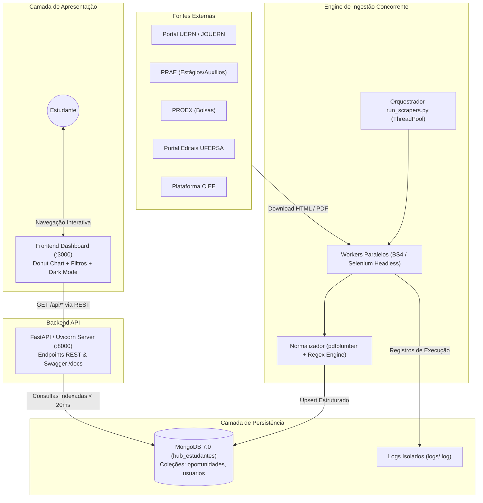

# EduScrap UERN – Plataforma Inteligente de Oportunidades Acadêmicas

<div align="center">


<p align="center">
  <strong>Hub centralizado de mineração, curadoria e monitoramento de editais, bolsas, estágios e notícias acadêmicas para o ecossistema universitário potiguar.</strong>
</p>

</div>

---

## Sobre o Projeto

O **EduScrap** (evolução do projeto *EstudanteHUB / TechHub*) é uma plataforma web completa desenvolvida no âmbito da disciplina de **Projeto Integrador** do Departamento de Informática (DI) da **Universidade do Estado do Rio Grande do Norte (UERN)**.

### A Problemática
No ambiente universitário regional, informações vitais para a permanência e formação discente encontram-se fragmentadas em múltiplos portais institucionais desarticulados (Jornal Oficial JOUERN em PDFs volumosos, sites da PRAE e PROEX, portais de faculdades isoladas, diários municipais, portais da UFERSA e plataformas corporativas como o CIEE). Essa descentralização provoca perda crônica de prazos regulamentares e impede que estudantes tenham acesso igualitário a bolsas e estágios.

### A Solução
O **EduScrap** resolve essa dor ao atuar como um agregador e minerador automatizado:
1. Executa **Web Scraping Paralelo Concorrente** em 8 fontes institucionais em segundo plano;
2. Aplica **Normalização por Expressões Regulares (Regex)** e leitura de PDFs para extrair prazos, valores de bolsas e requisitos;
3. Armazena os dados em um cluster NoSQL **MongoDB** otimizado com índices textuais;
4. Disponibiliza uma **API RESTful assíncrona** com **FastAPI** de tempo de resposta sub-segundo;
5. Entrega um **Dashboard SPA responsivo** com suporte a Tema Claro e Escuro, filtros por cursos e um inovador **gráfico Donut de prazos e vigência**.

---

## Funcionalidades Principais

- **Web Scraping Paralelo Multi-Worker (`run_scrapers.py`):** Coleta automatizada simultânea em 8 fontes oficiais com isolamento de logs individuais por robô em `logs/`.
-  **Validação Temporal Automática de Prazos:** Cálculo heurístico contínuo (Data Limite vs. Data Atual), classificando automaticamente certames em *"Aberto / Vigente"* ou *"Encerrado"*.
- **Painel Analítico de Prazos com Gráfico Donut:** Componente visual interativo em SVG que sintetiza a proporção de editais abertos versus encerrados em frações de segundo.
-  **Filtro Inteligente por Áreas e Cursos de Graduação:** Classificação semântica dos editais baseada no mapeamento institucional (`config/course_mapping.json`) para áreas como Tecnologia, Saúde, Humanas, Exatas e Sociais Aplicadas.
-  **Busca Textual em Tempo Real:** Filtragem instantânea no feed no lado do cliente por título, órgão emissor ou palavras-chave.
-  **Modo Escuro (Dark Mode) Dinâmico:** Alternância instantânea de tema (`theme.js`) com persistência em `localStorage` e troca automática de identidade visual para o logo de alto contraste (`assets/logo_temaescuro.png`).
-  **Área do Estudante e Favoritos:** Autenticação discente com hash seguro (`bcrypt`), seleção de cursos de interesse e possibilidade de salvar/favoritar editais no perfil.
-  **Documentação Interativa Swagger / OpenAPI:** Documentação completa e testável da API disponível nativamente em `/docs`.
-  **DevOps & Automação Completa:** Scripts de subida em um clique (`start.sh` e `Makefile`) e suíte de testes com `pytest`.

---

##  Arquitetura do Sistema

O EduScrap foi projetado sob o padrão de **Microsserviços Desacoplados** e **Coleta Assíncrona em Duas Fases**:



---

##  Inicialização Rápida em 1 Comando

Para subir todo o ecossistema (verificar e iniciar o **MongoDB**, subir a **API FastAPI** na porta 8000, o **Frontend** na porta 3000 e abrir automaticamente seu navegador):

```bash
./start.sh
```

> **Dica:** Você também pode utilizar o `Makefile` executando:
> ```bash
> make run
> ```

###  URLs da Aplicação Local:
- **Frontend Dashboard:** [http://localhost:3000](http://localhost:3000)
- **API REST Backend:** [http://localhost:8000](http://localhost:8000)
- **Documentação Interativa (Swagger):** [http://localhost:8000/docs](http://localhost:8000/docs)
- **Documentação Alternativa (ReDoc):** [http://localhost:8000/redoc](http://localhost:8000/redoc)

Para encerrar todos os serviços de uma só vez, pressione `Ctrl + C` no terminal.

---

##  Coleta de Dados (Web Scraping Paralelo Concorrente)

O orquestrador `run_scrapers.py` executa os robôs em threads concorrentes paralelas, garantindo que o processamento pesado ocorra em background sem degradar o tempo de resposta da API:

```bash
# Executa todas as fontes em paralelo multi-worker (Recomendado):
make scrape
# ou diretamente:
python run_scrapers.py

# Executa apenas fontes específicas (ex.: PRAE e UFERSA simultaneamente):
python run_scrapers.py prae ufersa

# Executa em modo sequencial (uma por vez):
python run_scrapers.py --serial

# Ver todas as opções e fontes disponíveis:
python run_scrapers.py --help
```

### Fontes Integradas:
| Chave | Nome da Fonte | Tipo de Extração | Coleção no Banco |
| :--- | :--- | :--- | :--- |
| `prae` | PRAE/UERN (Estágios e Auxílios) | HTML estático (Requests + BS4) | `vagas_estagio` |
| `proex` | PROEX/UERN (Bolsas e Projetos) | HTML estático (Requests + BS4) | `vagas_bolsa` |
| `ufersa` | UFERSA (Editais de Assistência) | Parse de editais em PDF/HTML | `vagas_ufersa` |
| `ciee` | CIEE (Estágios Comerciais Mossoró) | Automação dinâmica (Firefox Headless) | `vagas_ciee` |
| `portal_uern` | Portal Central UERN | Mineração textual e paginação | `vagas_portal_uern` |
| `noticias` | Notícias Tech & Inovação | Feed de notícias de tecnologia | `vagas_noticias` |
| `cpps_ufersa` | CPPS UFERSA | Processos seletivos acadêmicos | `editais` |
| `assecom_ufersa` | ASSECOM UFERSA | Comunicados e editais | `editais` |

>  **Isolamento de Logs:** Cada fonte salva seus próprios logs isoladamente em `logs/<chave>.log` (ex.: `logs/prae.log`, `logs/ciee.log`), permitindo depuração individual sem poluir o terminal.

---

## Diagramas Arquiteturais e UML

O projeto possui um conjunto completo de diagramas atualizados em conformidade com o código-fonte, disponibilizados em formatos **PNG** (alta resolução), **SVG** (vetorial) e **PUML** (PlantUML) na pasta [`diagramas_atualizados/`](diagramas_atualizados/):

| # | Diagrama | Descrição Arquitetural | Arquivos |
|:---:|:---|:---|:---:|
| **1** | **Casos de Uso (Atualizado)** | Modela as interações do *Estudante* (feed, busca textual, filtros de curso/área, monitoramento por Donut, favoritos e Dark Mode) e do *Administrador/DevOps* (coleta concorrente e monitoramento de logs). | [PNG](diagramas_atualizados/diagrama_01_casos_de_uso.png) • [SVG](diagramas_atualizados/diagrama_01_casos_de_uso.svg) • [PUML](diagramas_atualizados/diagrama_01_casos_de_uso.puml) |
| **2** | **Classes de Software** | Mapeamento das classes reais em Python: `FastAPIApplication`, modelos Pydantic (`OportunidadeModel`, `EstatisticasPrazos`), `ScraperRunner`, `BaseScraper`, scrapers concretos, `Normalizer` e `MongoDatabase`. | [PNG](diagramas_atualizados/diagrama_02_classes_software.png) • [SVG](diagramas_atualizados/diagrama_02_classes_software.svg) • [PUML](diagramas_atualizados/diagrama_02_classes_software.puml) |
| **3** | **Sequência: Coleta Paralela** | Fluxo multi-thread do `run_scrapers.py`: disparo concorrente, parse em HTML/PDF, higienização com Regex, persistência em lote no MongoDB e isolamento em `logs/`. | [PNG](diagramas_atualizados/diagrama_03_sequencia_coleta_paralela.png) • [SVG](diagramas_atualizados/diagrama_03_sequencia_coleta_paralela.svg) • [PUML](diagramas_atualizados/diagrama_03_sequencia_coleta_paralela.puml) |
| **4** | **Sequência: Consulta & Donut** | Fluxo síncrono do discente na SPA: requisição `GET /api/oportunidades`, consulta indexada no MongoDB (< 20ms) e agregação local para desenho dos arcos SVG do gráfico Donut. | [PNG](diagramas_atualizados/diagrama_04_sequencia_consulta_donut.png) • [SVG](diagramas_atualizados/diagrama_04_sequencia_consulta_donut.svg) • [PUML](diagramas_atualizados/diagrama_04_sequencia_consulta_donut.puml) |
| **5** | **Implantação & Infraestrutura** | Topologia física e lógica real: Nó Dispositivo Cliente (:3000), Nó Servidor Linux (Frontend HTTP, FastAPI :8000, Batch Runner, Storage local de logs) e Nó MongoDB (:27017). | [PNG](diagramas_atualizados/diagrama_05_implantacao_arquitetura.png) • [SVG](diagramas_atualizados/diagrama_05_implantacao_arquitetura.svg) • [PUML](diagramas_atualizados/diagrama_05_implantacao_arquitetura.puml) |
| **6** | **Componentes do Sistema** | Visão modular em 4 camadas desacopladas: Apresentação (Frontend), Serviços (FastAPI), Ingestão & Processamento e Persistência NoSQL. | [PNG](diagramas_atualizados/diagrama_06_componentes_sistema.png) • [SVG](diagramas_atualizados/diagrama_06_componentes_sistema.svg) • [PUML](diagramas_atualizados/diagrama_06_componentes_sistema.puml) |
| **7** | **Estados do Objeto Edital** | Máquina de estados: *Descoberto* ➔ *Em Extração* ➔ *Em Normalização* ➔ *Aberto / Vigente* ➔ *Prazo Crítico (≤ 3 dias)* ➔ *Encerrado* ou *Inválido*. | [PNG](diagramas_atualizados/diagrama_07_estados_edital.png) • [SVG](diagramas_atualizados/diagrama_07_estados_edital.svg) • [PUML](diagramas_atualizados/diagrama_07_estados_edital.puml) |

## Referência Completa da API REST

A API do EduScrap fornece os seguintes endpoints principais:

###  Oportunidades & Editais
| Método | Endpoint | Parâmetros de Query | Descrição |
|:---:|:---|:---|:---|
| `GET` | `/` | — | Informações gerais e status da API |
| `GET` | `/health` | — | Health check do serviço e conexão do banco |
| `GET` | `/api/estagios` | `limite`, `pagina` | Lista oportunidades de estágio da PRAE |
| `GET` | `/api/bolsas` | `limite`, `pagina` | Lista bolsas e auxílios da PROEX |
| `GET` | `/api/ufersa` | `limite`, `pagina` | Lista editais coletados da UFERSA |
| `GET` | `/api/ciee` | `limite`, `pagina` | Lista vagas de estágio corporativo do CIEE |
| `GET` | `/api/portal_uern`| `limite`, `pagina` | Editais gerais minerados do Portal UERN |
| `GET` | `/api/noticias` | `categoria` | Notícias acadêmicas e de inovação |
| `GET` | `/api/pesquisar` | `q`, `categoria`, `fonte`, `status` | Busca unificada textual e por filtros em tempo real |
| `GET` | `/api/estatisticas`| — | Métricas de vigência dos editais para o Gráfico Donut |
| `GET` | `/api/db-status` | — | Diagnóstico de latência e saúde do MongoDB |

### Autenticação & Perfil do Estudante
| Método | Endpoint | Cabeçalho / Body | Descrição |
|:---:|:---|:---|:---|
| `POST`| `/api/auth/register` | `{ nome, email, senha, curso }` | Cadastro de novo perfil de estudante |
| `POST`| `/api/auth/login` | `{ email, senha }` | Autenticação e geração de token seguro |
| `GET` | `/api/auth/me` | `Authorization: Bearer <token>` | Retorna dados do discente autenticado |
| `PUT` | `/api/auth/preferencias`| `{ cursos, areas }` | Atualiza áreas e cursos de interesse |
| `GET` | `/api/favoritos` | `Authorization: Bearer <token>` | Lista oportunidades favoritadas pelo discente |
| `POST`| `/api/favoritos/{id}` | `Authorization: Bearer <token>` | Salva oportunidade na lista de favoritos |
| `DELETE`| `/api/favoritos/{id}`| `Authorization: Bearer <token>` | Remove oportunidade dos favoritos |
| `GET` | `/api/feed/personalizado`| `Authorization: Bearer <token>` | Feed sob medida baseado nos cursos salvos |

---

## Estrutura do Projeto

```
EduScrap/
├── backend/
│   ├── api/                      # Módulos de autenticação e utilitários da API
│   ├── src/                      # Código-fonte principal
│   ├── main.py                   # Entry point da API RESTful (FastAPI + Uvicorn)
│   ├── database_setup.py         # Configuração de schema e índices no MongoDB
│   ├── scraper_*.py              # Scripts individuais de web scraping por portal
│   └── pdf_utils.py              # Utilitários de leitura e extração de PDF (pdfplumber)
├── frontend/
│   ├── assets/                   # Logotipos oficiais (tema claro e tema escuro)
│   ├── index.html                # Dashboard interativo SPA
│   ├── login.html                # Interface de autenticação do estudante
│   ├── style.css                 # Folha de estilos moderna (Tailwind + Custom CSS)
│   ├── script.js                 # Lógica de consumo da API, filtros e Donut Chart
│   └── theme.js                  # Controle dinâmico de Tema Claro/Escuro (Dark Mode)
├── config/
│   ├── course_mapping.json       # Mapeamento oficial de cursos por área acadêmica
│   └── patterns.json             # Padrões compilados de Regex para extração
├── tests/                        # Bateria de testes automatizados com Pytest
├── normalizer/                   # Módulos de normalização textual e validação de datas
├── Makefile                      # Atalhos para comandos rápidos (run, scrape, test, setup)
├── start.sh                      # Script de inicialização automática ponta a ponta
├── requirements.txt              # Dependências Python do ecossistema
└── README.md                     # Este documento
```

---

## Instalação Passo a Passo

### Pré-requisitos
- **Python 3.10 ou superior** (recomendado 3.12)
- **MongoDB 4.4 ou superior** (recomendado 7.0)
- **Git**

### Passo 1: Clonar o Repositório
```bash
git clone https://github.com/kelryana/EduScrap.git
cd EduScrap
```

### Passo 2: Configurar o Ambiente Virtual
```bash
# Criar ambiente virtual
python3 -m venv venv

# Ativar ambiente virtual (Linux/macOS):
source venv/bin/activate

# Ativar ambiente virtual (Windows):
venv\Scripts\activate
```

### Passo 3: Instalar as Dependências
```bash
pip install -r requirements.txt
```

### Passo 4: Inicializar o Banco de Dados
```bash
make setup
# ou manualmente:
python backend/database_setup.py
```

### Passo 5: Iniciar o Sistema
```bash
./start.sh
# ou:
make run
```

---

## Testes Automatizados

O EduScrap conta com uma suíte de testes unitários e de integração utilizando `pytest` e `mongomock`:

```bash
# Executar todos os testes:
make test

# Ou diretamente pelo pytest:
pytest tests/ -v
```

---

## Variáveis de Ambiente

Crie ou edite o arquivo `.env` na raiz do projeto ou na pasta `backend/` caso deseje personalizar a conexão:

```env
MONGODB_URI=mongodb://localhost:27017/
MONGODB_DB=hub_estudantes
LOG_LEVEL=INFO
DEBUG=True
SECRET_KEY=sua_chave_secreta_jwt_aqui
API_KEY=
```

---

## Equipe e Autores

- **Líder da Equipe & Desenvolvedora**  
   • GitHub: [@kelryana](https://github.com/kelryana)
- **Desenvolvedor**   
   • GitHub: [@PatoDesoxigenado](https://github.com/PatoDesoxigenado)

---

## Licença

Este projeto é software livre distribuído sob os termos da licença **MIT**. Consulte o arquivo [LICENSE](LICENSE) para mais detalhes.

<div align="center">
  <sub>Desenvolvido com dedicação para democratizar o acesso à informação na comunidade acadêmica da UERN e região.</sub>
</div>
