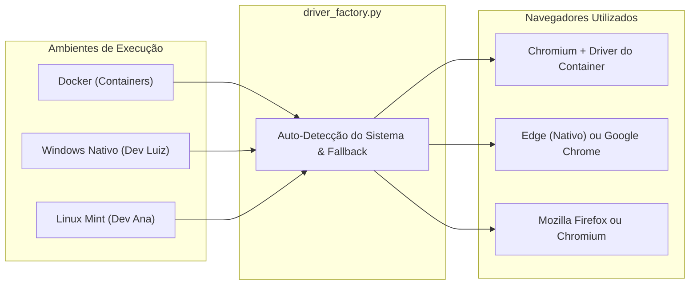

# EduScrap UERN – Plataforma de Oportunidades Acadêmicas

<div align="center">


<p align="center">
  <strong>Hub centralizado de mineração, curadoria e monitoramento de editais, bolsas, estágios e notícias acadêmicas para o ecossistema universitário potiguar.</strong>
</p>

</div>

---

## Sobre o Projeto

No ambiente universitário regional, informações vitais para a permanência e formação discente encontram-se fragmentadas em múltiplos portais institucionais desarticulados (Jornal Oficial JOUERN em PDFs volumosos, sites da PRAE e PROEX, portais de faculdades isoladas, diários municipais, portais da UFERSA e plataformas corporativas como o CIEE). Essa descentralização provoca perda crônica de prazos regulamentares e impede que estudantes tenham acesso igualitário a bolsas e estágios.

### A Solução
O **EduScrap** resolve essa dor ao atuar como um agregador e minerador automatizado:
1. **Web Scraping Paralelo Concorrente:** Robôs orientados a objetos (`BaseScraper`) orquestrados via `ThreadPoolExecutor` (`ScraperRunner`);

2. **Normalização Textual & Leitura de PDFs:** Parsing híbrido com Expressões Regulares (`RegexEngine`) e `pdfplumber`/`pdfminer` para extração de prazos, categorias e valores;
3. **Persistência NoSQL Indexada:** Cluster **MongoDB 7.0** encapsulado pela classe `MongoDatabase` com índices textuais compostos e busca instantânea;
4. **API RESTful Assíncrona:** Backend de alta performance com **FastAPI**, modelos tipados com **Pydantic** (`OportunidadeModel`), documentação Swagger interativa e latência sub-segundo (RNF01);
5. **Dashboard SPA Moderno:** Interface visual com Tema Claro/Escuro (`theme.js`), gráfico Donut interativo em SVG, seletores por curso e **Painel Administrativo de Governança Técnica**.

---

##  Funcionalidades Principais

- ⚡ **Web Scraping Concorrente Multi-Worker (`run_scrapers.py`):** Coleta paralela em múltiplas fontes com isolamento de logs individuais por robô em `logs/<fonte>.log`.

-  **Validação Temporal Automática de Prazos (RN01 a RN03):** Cálculo dinâmico comparando a data do servidor com os prazos de inscrição, gerando badges de alerta para prazos críticos ($\le$ 3 dias) e marcação de certames vencidos.
-  **Painel Analítico com Gráfico Donut (UC05):** Visualização interativa em SVG que renderiza em tempo real a proporção de editais abertos, vencendo em até 7 dias e encerrados.
-  **Filtro Inteligente por Áreas e Cursos (UC03):** Seletor dinâmico baseado em `config/course_mapping.json` contemplando 15 cursos e áreas temáticas (Tecnologia, Saúde, Humanas, Exatas, etc.).
-  **Feed Unificado e Busca Textual (UC01 / UC02 / Figura 4):** Endpoint consolidado `GET /api/oportunidades` para busca por palavra-chave, categoria, fonte e vigência.
-  **Modo Escuro (Dark Mode) Nativo (UC08):** Alternância instantânea de tema sem recarregar a página, com persistência no `localStorage` e troca de logo.
-  **Área do Estudante e Favoritos (UC06 / UC09):** Cadastro com termo de consentimento LGPD, autenticação com hash criptográfico (PBKDF2/SHA256) e gerenciamento de favoritos.
-  **Painel Administrativo de Governança Técnica (UC11 / UC12 / RF12):** Interface web (`admin.html`) para monitoramento de logs de robôs e ajuste de URLs e expressões de extração (`patterns.json`) em tempo de execução sem recompilar, com proteção contra SSRF.
-  **Portabilidade Total com Docker (RNF08 / Seção 12):** Empacotamento completo com `Dockerfile.backend`, `Dockerfile.frontend` e `docker-compose.yml`.

---

## Arquitetura do Sistema


---

## ⚡ Como Rodar o Projeto

Você pode iniciar o EduScrap de duas formas:

### Comparativo: Rodar Local (`start.sh`) vs. Via Docker (`docker compose`)

| Aspecto | 💻 Rodando Localmente (`./start.sh` ou `make run`) | 🐳 Rodando via Docker (`docker compose`) |
| :--- | :--- | :--- |
| **Isolamento** | Usa o ambiente da sua máquina (Python local, venv, navegadores e MongoDB do SO). | 100% isolado em containers (MongoDB, Python 3.12, Chromium e Frontend já prontos). |
| **Requisitos** | Requer Python 3.12, MongoDB instalado e rodando localmente, e virtualenv configurado. | Requer apenas o Docker instalado. Nada precisa ser instalado na máquina host. |
| **Navegador** | Usa o navegador instalado no seu SO (Firefox no Linux, Edge/Chrome no Windows). | Usa o **Chromium headless** embutido dentro da imagem Linux do container. |
| **Consumo de RAM** | Mais leve (executa diretamente na memória do SO sem camada de virtualização). | Limites definidos no compose (~1 GB para backend, 1 GB para mongo, 256 MB para frontend). |
| **Quando Usar?** | Ideal para desenvolvimento rápido, debug passo a passo e testes com pytest. | **Recomendado para produção**, padronização entre a equipe e deploy em servidores. |

---

### Opção A: Via Docker Compose (Recomendado)

Sobe todos os serviços (MongoDB 7.0, API FastAPI e Frontend) em containers isolados:

```bash
# Se tiver o plugin Compose v2 (padrão no Windows e Linux recente):
docker compose up --build -d

# Se estiver usando o Docker Compose clássico no Linux (com hífen):
docker-compose up --build -d
```

Para verificar o status dos containers:
```bash
docker compose ps       # ou: docker-compose ps
```

Para ver os logs em tempo real:
```bash
docker compose logs -f  # ou: docker-compose logs -f
```

Para parar os serviços:
```bash
docker compose down     # ou: docker-compose down
```

#### 🛠️ Solução de Problemas com Docker (Troubleshooting):

> [!WARNING]
> **No Linux (Linux Mint / Ubuntu):**
> * **Erro `FileNotFoundError: No such file or directory` ou `Error while fetching server API version`:**
>   * *Causa:* O serviço (daemon) do Docker está desligado.
>   * *Solução:* Inicie o serviço com:
>     ```bash
>     sudo systemctl start docker
>     sudo systemctl enable docker  # (opcional: inicia junto com o sistema)
>     ```
> * **Erro `permission denied while trying to connect to the Docker daemon socket`:**
>   * *Causa:* Seu usuário não pertence ao grupo `docker`.
>   * *Solução:* Execute `sudo usermod -aG docker $USER && newgrp docker`.
> * **Erro `unknown flag: --build` ao rodar `docker compose`:**
>   * *Causa:* O comando foi chamado com espaço mas o plugin v2 não está instalado.
>   * *Solução:* Use com hífen `docker-compose up --build -d` ou instale o plugin via `sudo apt install docker-compose-v2`.

> [!IMPORTANT]
> **No Windows (Dev Luiz e outros):**
> * **Erro `error during connect: This error may indicate that the docker daemon is not running`:**
>   * *Causa:* O aplicativo **Docker Desktop** está fechado.
>   * *Solução:* Abra o **Docker Desktop** pelo Menu Iniciar e aguarde o ícone da baleia no canto inferior indicar *"Engine running"*.
> * **Erro de integração com WSL2:**
>   * No Docker Desktop, vá em *Settings $\rightarrow$ Resources $\rightarrow$ WSL Integration* e certifique-se de ativar a distribuição utilizada (ex.: Ubuntu).

#### 🛑 Como Parar e Desativar o Docker do Início Automático (Economizar Memória RAM e Bateria):

Se você não quer que o Docker consuma memória e recursos em segundo plano ao ligar o computador:

* **No Linux (Linux Mint / Ubuntu):**
  1. **Desativar e parar completamente o serviço e o socket:**
     ```bash
     sudo systemctl disable --now docker.socket docker.service
     ```
  2. **Verificar se estão ambos inativos:**
     ```bash
     systemctl is-active docker docker.socket  # Deve retornar: inactive para ambos
     ```
  3. *(Quando precisar usar o Docker novamente, basta ligar sob demanda com `sudo systemctl start docker`).*

* **No Windows (Docker Desktop):**
  1. Abra o **Docker Desktop** e clique no ícone de **Configurações (Engrenagem)** no topo.
  2. Na aba **General**, desmarque a opção:
     ☑️ **Start Docker Desktop when you log in** $\rightarrow$ altere para desmarcado.
  3. Clique em **Apply & restart**.
  4. Para fechar o Docker agora e liberar RAM: clique com o botão direito no ícone da baleia (na barra de tarefas perto do relógio) e escolha **Quit Docker Desktop**.

---

### Opção B: Inicialização Local em 1 Comando (`start.sh`)

Garante a inicialização do MongoDB local, configuração dos índices de busca e execução paralela do Backend e Frontend:

```bash
./start.sh
```

> **Dica:** Você também pode utilizar o `Makefile`:
> ```bash
> make run
> ```

---

### URLs da Aplicação:

| Recurso | URL | Descrição |
| :--- | :--- | :--- |
| **Portal do Estudante** | [http://localhost:3000](http://localhost:3000) | Dashboard interativo, feed, Donut chart e modo escuro |
| **Painel de Governança** | [http://localhost:3000/admin.html](http://localhost:3000/admin.html) | Monitor de logs e editor de regras de extração (UC11/UC12) |
| **API Backend** | [http://localhost:8000](http://localhost:8000) | Servidor FastAPI sob Uvicorn |
| **Documentação Interativa (Swagger)** | [http://localhost:8000/docs](http://localhost:8000/docs) | Testador interativo de endpoints e esquemas OpenAPI |
| **Documentação Alternativa (ReDoc)** | [http://localhost:8000/redoc](http://localhost:8000/redoc) | Documentação formal da API REST |

---

## Coleta de Dados (Web Scraping Paralelo Concorrente)

O orquestrador `ScraperRunner` em `run_scrapers.py` dispara as varreduras em threads paralelas sem degradar a API:

```bash
# Executa todas as fontes em paralelo multi-worker (Local):
python run_scrapers.py
# ou:
make scrape

# Executa apenas fontes específicas (ex.: PRAE e CIEE):
python run_scrapers.py prae ciee

# Executa em modo sequencial:
python run_scrapers.py --serial

# Se você estiver usando o Docker Compose:
docker compose exec backend python scraper_ciee.py
docker compose run --rm scraper-runner python run_scrapers.py
```

### Fontes Integradas:
| Chave | Nome da Fonte | Implementação POO | Coleção no Banco |
| :--- | :--- | :--- | :--- |
| `prae` | PRAE/UERN (Estágios e Auxílios) | `ScraperPRAE` (BaseScraper) | `vagas_estagio` |
| `proex` | PROEX/UERN (Bolsas e Projetos) | `ScraperPROEX` (BaseScraper) | `vagas_bolsa` |
| `ufersa` | UFERSA (Editais de Assistência) | `ScraperUFERSA` (BaseScraper) | `vagas_ufersa` |
| `ciee` | CIEE (Estágios Comerciais Mossoró) | `ScraperCIEEHibrido` | `vagas_ciee` |
| `portal_uern` | Portal Central UERN | Mineração textual e paginação | `vagas_portal_uern` |
| `noticias` | Notícias Tech & Inovação | Feed RSS / Mineração HTML | `vagas_noticias` |
| `cpps_ufersa` | CPPS UFERSA | Processos seletivos acadêmicos | `editais` |
| `assecom_ufersa` | ASSECOM UFERSA | Comunicados oficiais | `noticias` |
| `mprn` | MPRN | Estágios e residência jurídica | `vagas` |
| `iel_rn` | IEL/RN | Vagas corporativas e estágios | `vagas` |
| `ifrn` | IFRN | Processos seletivos e bolsas | `editais` |
| `dom_mossoro` | DOM Mossoró | Editais municipais oficiais | `editais` |

### 🛠️ Solução de Problemas nas Vagas do CIEE e Web Scraping (Troubleshooting):

> [!TIP]
> **1. Todos os links do CIEE levando para a página inicial geral (`https://portal.ciee.org.br/`) em vez da vaga individual:**
> * **Sintoma:** No MongoDB Compass ou ao clicar no botão do card, o campo `link` aponta apenas para `https://portal.ciee.org.br/` em todas as vagas.
> * **Causa:** O container HTML do card no portal do CIEE possui âncoras institucionais (`<a>`) que apontam para a home do site. Em versões anteriores, a captura genérica do primeiro `<a>` sobrescrevia a URL parametrizada da vaga.
> * **Como foi resolvido e como corrigir seu banco:**
>   1. O método `_montar_link` em [`backend/scraper_ciee.py`](file:///home/ana/projetos/EduScrap/backend/scraper_ciee.py) agora filtra e ignora links da homepage ou âncoras vazias (`#`, `javascript:void(0)`), fixando o link direto da oportunidade: `https://portal.ciee.org.br/quero-uma-vaga/?codigoVaga={CODIGO}`.
>   2. **Auto-migração no `./start.sh`:** Ao rodar `./start.sh` (ou `python3 backend/database_setup.py`), o sistema localiza automaticamente documentos antigos na coleção `vagas_ciee` que estejam com o link genérico, extrai o código da vaga (ex.: `[6238649]`) e atualiza o campo `link` no MongoDB sem precisar rodar o scraper novamente.
>   3. A API ([`backend/main.py`](file:///home/ana/projetos/EduScrap/backend/main.py)) e o Frontend ([`frontend/script.js`](file:///home/ana/projetos/EduScrap/frontend/script.js)) também convertem links genéricos em tempo real e exibem o botão **"Ver Vaga no CIEE"**.

> [!TIP]
> **2. Cards do CIEE aparecendo apenas com o título repetido `"Vaga CIEE"` (sem área, código ou bolsa):**
> * **Sintoma:** Todos os cards da aba CIEE mostram apenas `"Vaga CIEE"` no título, ocultando a área de atuação e o valor da bolsa.
> * **Causa:** O scraper gravava apenas a modalidade genérica no campo `titulo` e deixava a string detalhada apenas em `nome_completo`, que era ignorada pelo frontend quando `titulo` já existia.
> * **Como foi resolvido:**
>   1. O scraper agora salva o título completo diretamente em `titulo` e `nome` no formato `[CÓDIGO] Modalidade - Área (Remuneração)`.
>   2. O backend e o frontend enriquecem automaticamente registros antigos e exibem linhas dedicadas com ícones para **Remuneração** (💰) e **Localidade** (📍).
>   3. Caso queira forçar a atualização semântica de todos os registros existentes no banco local, basta rodar:
>      ```bash
>      ./venv/bin/python backend/enriquecer_banco.py
>      ```

> [!TIP]
> **3. Erro `Service geckodriver exited with Status code: 127` ou navegador não encontrado (Windows / Linux / Docker):**
> * **Causa:** Ocorria quando a máquina não possuía o Firefox instalado (comum no Windows usando apenas Edge/Chrome) ou quando o container Docker rodava uma imagem antiga em cache sem as bibliotecas do navegador.
> * **Solução:**
>   * **Local (Windows/Linux):** A fábrica unificada [`backend/driver_factory.py`](file:///home/ana/projetos/EduScrap/backend/driver_factory.py) detecta automaticamente o sistema operacional e faz fallback entre **Chrome, Chromium, Microsoft Edge, Brave e Firefox**. Você também pode forçar um navegador específico no `.env` com `SELENIUM_BROWSER=edge` (ou `chrome` / `firefox`).
>   * **No Docker:** Reconstrua a imagem invalidando o cache antigo para instalar o `chromium` e `chromium-driver` nativos:
>     ```bash
>     docker compose down --rmi local
>     docker compose up --build -d --force-recreate
>     # Ou via Makefile:
>     make docker-rebuild
>     ```

---

## Referência da API RESTful (FastAPI)

### Oportunidades & Editais
| Método | Endpoint | Parâmetros Principais | Descrição |
|:---:|:---|:---|:---|
| `GET` | `/` | — | Status da API e versão do EduScrap |
| `GET` | `/api/oportunidades` | `categoria`, `fonte`, `busca`, `apenas_vigentes`, `pagina`, `limite` | **Feed unificado e consolidado** com filtros e ordenação temporal (Figura 4) |
| `GET` | `/api/estagios` | `pagina`, `limite`, `apenas_vigentes` | Oportunidades de estágio |
| `GET` | `/api/bolsas` | `pagina`, `limite`, `apenas_vigentes` | Bolsas e auxílios acadêmicos |
| `GET` | `/api/ufersa` | `pagina`, `limite`, `apenas_vigentes` | Editais da UFERSA |
| `GET` | `/api/ciee` | `pagina`, `limite`, `apenas_vigentes` | Vagas corporativas CIEE |
| `GET` | `/api/pesquisar` | `termo` | Busca textual por Regex/Text index |
| `GET` | `/api/estatisticas`| — | Métricas de prazos e vigência para o Gráfico Donut |

### Autenticação & Favoritos (Estudante)
| Método | Endpoint | Header / Payload | Descrição |
|:---:|:---|:---|:---|
| `POST`| `/api/auth/register` | `{ nome, email, senha, matricula, curso }` | Cadastro discente com aceite de termos |
| `POST`| `/api/auth/login` | `{ email, senha }` | Autenticação e geração de token JWT |
| `GET` | `/api/auth/me` | `Bearer <token>` | Perfil do usuário autenticado |
| `GET` | `/api/favoritos` | `Bearer <token>` | Listagem de favoritos do estudante |
| `POST`| `/api/favoritos/{id}` | `Bearer <token>` | Adiciona oportunidade aos favoritos |
| `DELETE`| `/api/favoritos/{id}`| `Bearer <token>` | Remove oportunidade dos favoritos |
| `GET` | `/api/feed/personalizado`| `Bearer <token>` | Feed customizado por cursos de interesse |

### Governança Técnica, Monitoramento e Logs (UC11 / UC12)
| Método | Endpoint | Header / Payload | Descrição |
|:---:|:---|:---|:---|
| `GET` | `/api/admin/regras` | `X-API-Key` ou `Bearer <token>` | Consulta regras de extração do `patterns.json` |
| `PUT` | `/api/admin/regras` | `X-MFA-Code`, JSON com regras | Atualiza regras em tempo de execução com proteção MFA (TOTP) |
| `GET` | `/api/admin/fontes` | `X-API-Key` ou `Bearer <token>` | Lista parâmetros e fontes ativas cadastradas |
| `GET` | `/api/logs` | — | Dashboard consolidado com status, duração e itens de todos os scrapers |
| `GET` | `/api/logs/{fonte}` | — | Parser estruturado em JSON do log individual do scraper (`logs/<fonte>.log`) |
| `GET` | `/api/snapshots/{id}`| — | Download e visualização do snapshot do PDF armazenado no GridFS |
| `GET` | `/api/auth/mfa/status`| — | Consulta se o Segundo Fator de Autenticação (MFA) está ativo |
| `POST`| `/api/auth/mfa/setup` | `X-API-Key` ou `Bearer <token>` | Gera segredo Base32 e URI para app autenticador |
| `POST`| `/api/auth/mfa/ativar`| `{ codigo, secret }` | Valida código TOTP e ativa o MFA permanentemente |

---

## Deploy e Infraestrutura Multiplataforma

### Compatibilidade: Desenvolvimento (Windows) vs. Implantação (Linux Mint)

O EduScrap foi arquitetado para permitir desenvolvimento fluido em máquinas **Windows** e implantação estável em servidores ou estações **Linux Mint**:

| Recurso / Componente | Ambiente de Desenvolvimento (Windows) | Ambiente de Implantação (Linux Mint) | Comportamento / Ação Técnica |
|:---|:---:|:---:|:---|
| **Navegadores & WebDrivers (Selenium)** | Auto-detecção: Chrome $\rightarrow$ Edge $\rightarrow$ Brave $\rightarrow$ Firefox | Auto-detecção: Firefox $\rightarrow$ Chromium/Chrome | **Fábrica Unificada (`driver_factory.py`):** Elimina dependências rígidas. No Windows usa navegadores Chromium instalados (Edge nativo ou Chrome); no Linux usa Firefox ou Chromium; no Docker usa Chromium pré-instalado. |
| **Eliminação de Zombies Chrome** | `taskkill /F /IM chrome.exe` | `pkill -f chrome` | **Multiplataforma automático:** `matar_processos_chrome()` detecta `sys.platform == "win32"` e executa o utilitário nativo correspondente. |
| **Swappiness de Memória** | Gerenciado pelo `pagefile.sys` | `vm.swappiness=10` no `/etc/sysctl.conf` | `swappiness` é exclusivo do kernel Linux. No Windows, a memória virtual é tratada nativamente sem parâmetros adicionais. |
| **Agendamento de Notificações e Limpeza** | Execução direta manual ou Agendador de Tarefas (`schtasks`) | **Systemd Timers** (`.service` + `.timer`) | No Linux Mint, os timers garantem dependência estrita (`After=eduscrap-scraper.service`). No Windows, os scripts são executados via `python notify_users.py` ou `schtasks`. |
| **Docker Compose Limits** | Docker Desktop (WSL2) | Docker Engine (cgroups nativos) | No Windows, o WSL2 introduz uma leve camada de overhead. Se a máquina host possuir 8 GB de RAM, os limites de containers podem ser ajustados para 512 MB durante o desenvolvimento local. |

---

### Guia de Navegadores para Web Scraping (CIEE & Portal UERN)

Os scrapers de plataformas dinâmicas (**CIEE** e **Portal UERN**) utilizam automação headless via Selenium. Para garantir que qualquer membro da equipe consiga executar a raspagem sem conflito de navegadores, o projeto utiliza a **Fábrica de Drivers Unificada** (`backend/driver_factory.py`).

#### Como Funciona por Ambiente:



| Ambiente | Navegador Padrão | Requisitos / Dependências | Como Executar |
| :--- | :--- | :--- | :--- |
| **Docker Compose** *(Qualquer SO)* | **Chromium** (embutido no container) | Nenhuma no host! Instalado automaticamente no container via `Dockerfile.backend`. | `docker compose exec backend python scraper_ciee.py`<br>ou `docker compose run --rm scraper-runner python run_scrapers.py ciee` |
| **Windows Nativo** *(Devs sem Firefox)* | **Microsoft Edge** ou **Chrome / Brave** | Ter o **Microsoft Edge** (já vem nativo no Windows 10/11) ou **Google Chrome** instalado. Não precisa de Firefox! | `python backend/scraper_ciee.py`<br>ou `python run_scrapers.py ciee` |
| **Linux Mint / Ubuntu** | **Mozilla Firefox** ou **Chromium** | `firefox` instalado (`sudo apt install firefox`) ou `chromium` (`sudo apt install chromium chromium-driver`). | `python backend/scraper_ciee.py`<br>ou `python run_scrapers.py ciee` |

#### Variáveis de Ambiente Opcionais (`.env`):
Caso deseje forçar um navegador ou caminho específico, adicione ao seu arquivo `.env`:
```ini
# Opções: auto (padrão com fallback), chrome, edge, brave, firefox
SELENIUM_BROWSER=auto

# (Opcional) Caminhos manuais para binários ou drivers:
# CHROME_BINARY_PATH="C:\Program Files\Google\Chrome\Application\chrome.exe"
# BRAVE_PATH="C:\Program Files\BraveSoftware\Brave-Browser\Application\brave.exe"
# CHROMEDRIVER_PATH="/usr/bin/chromedriver"
# GECKODRIVER_PATH=""
```

#### Solução de Problemas Frequentes (Troubleshooting):

> [!TIP]
> **Erro: `Status code was: 127` ao rodar dentro do Docker**
> * **Causa:** O container Docker foi iniciado a partir de uma imagem antiga sem os pacotes do Chromium instalados.
> * **Solução:** Reconstrua as imagens do Docker sem cache:
>   ```bash
>   docker compose build --no-cache backend scraper-runner
>   docker compose up -d
>   ```

> [!NOTE]
> **Erro: `Expected browser binary location, but unable to find binary`**
> * **Causa:** O Selenium tentou abrir o Firefox em uma máquina que não possui o Firefox instalado (comum no Windows).
> * **Solução:** O `driver_factory.py` já faz o fallback automático para o **Edge** ou **Chrome**. Se ainda ocorrer, verifique se o Microsoft Edge ou Chrome estão instalados ou configure explicitamente no `.env`: `SELENIUM_BROWSER=edge` ou `SELENIUM_BROWSER=chrome`.


### 1. Limites de Recursos no Docker Compose
Para impedir que um container monopolize a memória RAM e cause travamento no sistema (OOM Killer), o `docker-compose.yml` define limites estritos e políticas de reinicialização resilientes:

- **MongoDB 7.0:** Limite de 1 GB de RAM (`deploy.resources.limits.memory: 1G`).
- **Backend FastAPI:** Limite de 1 GB de RAM (`deploy.resources.limits.memory: 1G`).
- **ScraperRunner:** Limite de 1 GB de RAM, `restart: on-failure:3` (evita restart loops em caso de OOM) e `healthcheck` ativo monitorando o processo (`pgrep -f run_scrapers.py`).
- **Frontend SPA:** Limite de 256 MB de RAM (`deploy.resources.limits.memory: 256M`).

```bash
# Inicializar todo o ecossistema com limites aplicados:
docker compose up -d --build
```

### 2. Automação e Orquestração com Systemd Timers (Exclusivo Linux Mint)
O EduScrap substitui o CRON tradicional por **Systemd Timers**, garantindo que notificações só rodam após a coleta terminar (`After=eduscrap-scraper.service`) com integração nativa ao `journalctl`:

- `eduscrap-scraper.service`: Executa a coleta paralela `run_scrapers.py`.
- `eduscrap-notify.service` e `eduscrap-notify.timer`: Script autônomo `notify_users.py` que varre editais com vencimento em até 3 dias ($\le$ 3 dias), consulta usuários interessados e dispara alertas por E-mail (SMTP) e Telegram Bot Webhook.
- `eduscrap-cleanup.service` e `eduscrap-cleanup.timer`: Script de retenção `cleanup_snapshots.py` que remove snapshots de PDFs no GridFS com mais de 12 meses (365 dias), preservando o armazenamento SSD.

```bash
# Instalação automatizada das units do systemd (apenas no Linux):
sudo ./systemd/install_systemd.sh
```

> **Nota para o Desenvolvimento no Windows:**
> Como o `systemd` é exclusivo do ecossistema Linux, durante o desenvolvimento no Windows você pode testar as notificações e limpeza executando os scripts diretamente no terminal:
> ```cmd
> python notify_users.py
> python cleanup_snapshots.py --dias 365
> ```
> Para agendamento local automatizado no Windows, use o Agendador de Tarefas (`schtasks /create /tn "EduScrapNotify" /tr "python notify_users.py" /sc daily /st 07:00`).

### 3. Preservação de Documentos com Snapshots no GridFS
Para proteger a plataforma contra a volatilidade e expiração de links nos portais institucionais externos, os scrapers armazenam os PDFs originais no **GridFS do MongoDB**:
- Gravação via `gridfs.GridFS(db).put(pdf_bytes, filename=...)`;
- Recuperação via endpoint streaming `/api/snapshots/{file_id}`;
- Purga automática após 12 meses via script `cleanup_snapshots.py`.

### 4. Acessibilidade e Contraste WCAG 2.1 AA
O frontend adota paleta de cores estritamente validada pelo **WebAIM Contrast Checker** (mínimo 4.5:1):
- Texto em fundo claro: `#B71C1C` (relação de contraste 7.0:1 contra branco).
- Badges e textos em fundo escuro: `#EF5350` (relação de contraste 4.8:1 contra `#0F172A`).
- Redundância visual: ícones de estado aliados a cores e textos explícitos (WCAG 1.4.1).

### 5. Exportação para Calendário iCalendar (.ics)
Todo edital com data limite possui o botão **"Adicionar ao Calendário"** no card, gerando arquivos `.ics` em formato padrão **RFC 5545** diretamente no navegador via `Blob`, permitindo sincronização instantânea com Google Agenda, Outlook e Apple Calendar com zero sobrecarga de RAM no backend.

---

## Testes Automatizados (Pytest)

A suíte de testes cobre 100% dos módulos do sistema, incluindo integração NoSQL, Regex, extração de PDFs, MFA (pyotp), logs REST, snapshots GridFS e testes de desempenho:

```bash
# Executar toda a suíte de testes:
pytest -v
# ou:
./venv/bin/pytest tests/ -v
```

**Resultado:** `104 passed, 0 failed` (100% de sucesso).

> **Nota:** Os testes são executados manualmente antes de cada commit. Não há pipeline de CI/CD configurado no repositório.

---

## Estrutura do Repositório

```
EduScrap/
├── backend/
│   ├── driver_factory.py         # Fábrica unificada de WebDrivers (Chrome, Edge, Brave, Firefox)
│   ├── base_scraper.py           # Classe abstrata BaseScraper (RNF05 / Figura 11)
│   ├── models.py                 # Modelos Pydantic de domínio (OportunidadeModel, etc.)
│   ├── mongo_database.py         # Classe MongoDatabase para persistência NoSQL
│   ├── main.py                   # API RESTful FastAPI (MFA, Logs, Snapshots, Oportunidades)
│   ├── database_setup.py         # Criação de índices e validação de schema
│   ├── scraper_*.py              # Classes e scripts dos robôs de coleta
│   └── pdf_utils.py              # Extração de datas e snapshots via GridFS
├── frontend/
│   ├── index.html                # Interface principal do estudante (Dashboard SPA)
│   ├── admin.html                # Painel de governança técnica (UC11 / UC12 / MFA)
│   ├── login.html                # Autenticação e cadastro
│   ├── script.js                 # Lógica de filtros, .ics e consumo da API
│   ├── theme.js                  # Controle dinâmico de Modo Claro e Escuro
│   └── style.css                 # Estilização Tailwind e regras de contraste WCAG 2.1
├── systemd/
│   ├── eduscrap-scraper.service  # Unit de coleta concorrente
│   ├── eduscrap-notify.service   # Unit de notificação de prazos
│   ├── eduscrap-notify.timer     # Timer de disparo de notificações
│   ├── eduscrap-cleanup.service  # Unit de limpeza de snapshots GridFS
│   ├── eduscrap-cleanup.timer    # Timer semanal de purga de retenção
│   └── install_systemd.sh        # Script de instalação e ativação no SO
├── notify_users.py               # Notificador autônomo multicanal (SMTP + Telegram)
├── cleanup_snapshots.py          # Script de retenção de snapshots GridFS (> 12 meses)
├── config/
│   ├── course_mapping.json       # Mapeamento oficial de 15 cursos e áreas
│   └── patterns.json             # Regras compiladas de Regex para extração
├── tests/
│   ├── test_driver_factory.py    # Testes de auto-detecção de navegadores e fallback Selenium
│   ├── test_novas_funcionalidades.py # Testes de MFA, logs, GridFS, .ics e notificações
│   ├── test_fastapi_endpoints.py # Testes dos endpoints FastAPI e admin
│   ├── test_performance.py       # Teste de latência do feed < 1s (RNF01)
│   ├── test_auth_favoritos.py    # Testes de autenticação e favoritos
│   ├── test_database_mongomock.py# Testes de persistência NoSQL
│   ├── test_pdf_utils.py         # Testes de extração de PDF e vigência
│   ├── test_regex.py             # Testes do motor de expressões regulares
│   └── test_scraper.py           # Testes dos coletores HTML e PDF
├── Dockerfile.backend            # Container para a API FastAPI
├── Dockerfile.frontend           # Container para o Frontend SPA
├── docker-compose.yml            # Orquestração com limites de RAM e healthcheck
├── run_scrapers.py               # Orquestrador ScraperRunner com pkill zombie cleanup
├── start.sh                      # Script de inicialização automática local
├── Makefile                      # Atalhos úteis de desenvolvimento
├── requirements.txt              # Dependências Python (com pyotp e responses)
└── README.md                     # Este documento
```

---

## Equipe e Autoria

Projeto acadêmico desenvolvido para a **Universidade do Estado do Rio Grande do Norte (UERN)**:

  GitHub: [@kelryana](https://github.com/kelryana)

---

## Licença

Distribuído sob os termos da licença **MIT**. Consulte o arquivo [LICENSE](LICENSE) para mais detalhes.
