# Project Graph

> [!NOTE]
> Autogenerated dependency map for Obsidian and Antigravity Token Optimization.
> **Generated at**: 2026-11-17 07:40:24 | **Detected Stack**: Python | **Total Files Indexed**: 106

## Architecture Graph (Mermaid.js)

```mermaid
graph TD
    classDef default fill:#1e1e2e,stroke:#89b4fa,stroke-width:1px,color:#cdd6f4;
    backend_api_app_py["[[backend/api/app.py]]"] --> backend_api_routes_py["[[backend/api/routes.py]]"]
    backend_api_auth_py["[[backend/api/auth.py]]"] --> backend_api_routes_py["[[backend/api/routes.py]]"]
    backend_api_routes_py["[[backend/api/routes.py]]"] --> backend_api_auth_py["[[backend/api/auth.py]]"]
    backend_main_py["[[backend/main.py]]"] --> backend_base_scraper_py["[[backend/base_scraper.py]]"]
    backend_main_py["[[backend/main.py]]"] --> backend_models_py["[[backend/models.py]]"]
    backend_main_py["[[backend/main.py]]"] --> backend_mongo_database_py["[[backend/mongo_database.py]]"]
    backend_main_py["[[backend/main.py]]"] --> backend_pdf_utils_py["[[backend/pdf_utils.py]]"]
    backend_main_py["[[backend/main.py]]"] --> backend_scraper_noticias_py["[[backend/scraper_noticias.py]]"]
    backend_main_py["[[backend/main.py]]"] --> run_scrapers_py["[[run_scrapers.py]]"]
    backend_scraper_assecom_ufersa_py["[[backend/scraper_assecom_ufersa.py]]"] --> backend_base_scraper_py["[[backend/base_scraper.py]]"]
    backend_scraper_capacitacao_bolsas_py["[[backend/scraper_capacitacao_bolsas.py]]"] --> backend_base_scraper_py["[[backend/base_scraper.py]]"]
    backend_scraper_ciee_py["[[backend/scraper_ciee.py]]"] --> backend_driver_factory_py["[[backend/driver_factory.py]]"]
    backend_scraper_cpps_ufersa_py["[[backend/scraper_cpps_ufersa.py]]"] --> backend_base_scraper_py["[[backend/base_scraper.py]]"]
    backend_scraper_dom_mossoro_py["[[backend/scraper_dom_mossoro.py]]"] --> backend_base_scraper_py["[[backend/base_scraper.py]]"]
    backend_scraper_iel_rn_py["[[backend/scraper_iel_rn.py]]"] --> backend_base_scraper_py["[[backend/base_scraper.py]]"]
    backend_scraper_ifrn_py["[[backend/scraper_ifrn.py]]"] --> backend_base_scraper_py["[[backend/base_scraper.py]]"]
    backend_scraper_mprn_py["[[backend/scraper_mprn.py]]"] --> backend_base_scraper_py["[[backend/base_scraper.py]]"]
    backend_scraper_noticias_py["[[backend/scraper_noticias.py]]"] --> backend_base_scraper_py["[[backend/base_scraper.py]]"]
    backend_scraper_portal_uern_py["[[backend/scraper_portal_uern.py]]"] --> backend_base_scraper_py["[[backend/base_scraper.py]]"]
    backend_scraper_portal_uern_py["[[backend/scraper_portal_uern.py]]"] --> backend_driver_factory_py["[[backend/driver_factory.py]]"]
    backend_scraper_portal_uern_py["[[backend/scraper_portal_uern.py]]"] --> backend_pdf_utils_py["[[backend/pdf_utils.py]]"]
    backend_scraper_prae_py["[[backend/scraper_prae.py]]"] --> backend_base_scraper_py["[[backend/base_scraper.py]]"]
    backend_scraper_prae_py["[[backend/scraper_prae.py]]"] --> backend_pdf_utils_py["[[backend/pdf_utils.py]]"]
    backend_scraper_proex_py["[[backend/scraper_proex.py]]"] --> backend_base_scraper_py["[[backend/base_scraper.py]]"]
    backend_scraper_proex_py["[[backend/scraper_proex.py]]"] --> backend_pdf_utils_py["[[backend/pdf_utils.py]]"]
    backend_scraper_ufersa_py["[[backend/scraper_ufersa.py]]"] --> backend_base_scraper_py["[[backend/base_scraper.py]]"]
    backend_scraper_ufersa_py["[[backend/scraper_ufersa.py]]"] --> backend_pdf_utils_py["[[backend/pdf_utils.py]]"]
    run_scrapers_py["[[run_scrapers.py]]"] --> backend_base_scraper_py["[[backend/base_scraper.py]]"]
    tests_test_driver_factory_py["[[tests/test_driver_factory.py]]"] --> backend_driver_factory_py["[[backend/driver_factory.py]]"]
    tests_test_driver_factory_py["[[tests/test_driver_factory.py]]"] --> backend_scraper_ciee_py["[[backend/scraper_ciee.py]]"]
    tests_test_driver_factory_py["[[tests/test_driver_factory.py]]"] --> backend_scraper_portal_uern_py["[[backend/scraper_portal_uern.py]]"]
    tests_test_novas_funcionalidades_py["[[tests/test_novas_funcionalidades.py]]"] --> cleanup_snapshots_py["[[cleanup_snapshots.py]]"]
    tests_test_novas_funcionalidades_py["[[tests/test_novas_funcionalidades.py]]"] --> notify_users_py["[[notify_users.py]]"]
    tests_test_novas_funcionalidades_py["[[tests/test_novas_funcionalidades.py]]"] --> run_scrapers_py["[[run_scrapers.py]]"]
```

## Node Index & Dependencies (Wikilinks)

### [[.dockerignore]]
- **Dependencies (Imports)**: None
- **Referenced By (Dependents)**: Entrypoint or unreferenced

### [[.gitignore]]
- **Dependencies (Imports)**: None
- **Referenced By (Dependents)**: Entrypoint or unreferenced

### [[.pytest_cache/.gitignore]]
- **Dependencies (Imports)**: None
- **Referenced By (Dependents)**: Entrypoint or unreferenced

### [[.pytest_cache/CACHEDIR.TAG]]
- **Dependencies (Imports)**: None
- **Referenced By (Dependents)**: Entrypoint or unreferenced

### [[.pytest_cache/README.md]]
- **Dependencies (Imports)**: None
- **Referenced By (Dependents)**: Entrypoint or unreferenced

### [[.pytest_cache/v/cache/lastfailed]]
- **Dependencies (Imports)**: None
- **Referenced By (Dependents)**: Entrypoint or unreferenced

### [[.pytest_cache/v/cache/nodeids]]
- **Dependencies (Imports)**: None
- **Referenced By (Dependents)**: Entrypoint or unreferenced

### [[.rules.md]]
- **Dependencies (Imports)**: None
- **Referenced By (Dependents)**: Entrypoint or unreferenced

### [[Dockerfile.backend]]
- **Dependencies (Imports)**: None
- **Referenced By (Dependents)**: Entrypoint or unreferenced

### [[Dockerfile.frontend]]
- **Dependencies (Imports)**: None
- **Referenced By (Dependents)**: Entrypoint or unreferenced

### [[GEMINI.md]]
- **Dependencies (Imports)**: None
- **Referenced By (Dependents)**: Entrypoint or unreferenced

### [[LICENSE]]
- **Dependencies (Imports)**: None
- **Referenced By (Dependents)**: Entrypoint or unreferenced

### [[Makefile]]
- **Dependencies (Imports)**: None
- **Referenced By (Dependents)**: Entrypoint or unreferenced

### [[README.md]]
- **Dependencies (Imports)**: None
- **Referenced By (Dependents)**: Entrypoint or unreferenced

### [[backend/api/app.py]]
- **Dependencies (Imports)**:
  - [[backend/api/routes.py]]
- **Referenced By (Dependents)**: Entrypoint or unreferenced

### [[backend/api/auth.py]]
- **Dependencies (Imports)**:
  - [[backend/api/routes.py]]
- **Referenced By (Dependents)**:
  - [[backend/api/routes.py]]

### [[backend/api/routes.py]]
- **Dependencies (Imports)**:
  - [[backend/api/auth.py]]
- **Referenced By (Dependents)**:
  - [[backend/api/app.py]]
  - [[backend/api/auth.py]]

### [[backend/base_scraper.py]]
- **Dependencies (Imports)**: None
- **Referenced By (Dependents)**:
  - [[backend/main.py]]
  - [[backend/scraper_assecom_ufersa.py]]
  - [[backend/scraper_capacitacao_bolsas.py]]
  - [[backend/scraper_cpps_ufersa.py]]
  - [[backend/scraper_dom_mossoro.py]]
  - [[backend/scraper_iel_rn.py]]
  - [[backend/scraper_ifrn.py]]
  - [[backend/scraper_mprn.py]]
  - [[backend/scraper_noticias.py]]
  - [[backend/scraper_portal_uern.py]]
  - [[backend/scraper_prae.py]]
  - [[backend/scraper_proex.py]]
  - [[backend/scraper_ufersa.py]]
  - [[run_scrapers.py]]

### [[backend/check_portal.sh]]
- **Dependencies (Imports)**: None
- **Referenced By (Dependents)**: Entrypoint or unreferenced

### [[backend/config.py]]
- **Dependencies (Imports)**: None
- **Referenced By (Dependents)**: Entrypoint or unreferenced

### [[backend/database.py]]
- **Dependencies (Imports)**: None
- **Referenced By (Dependents)**: Entrypoint or unreferenced

### [[backend/database_setup.py]]
- **Dependencies (Imports)**: None
- **Referenced By (Dependents)**: Entrypoint or unreferenced

### [[backend/driver_factory.py]]
- **Dependencies (Imports)**: None
- **Referenced By (Dependents)**:
  - [[backend/scraper_ciee.py]]
  - [[backend/scraper_portal_uern.py]]
  - [[tests/test_driver_factory.py]]

### [[backend/enriquecer_banco.py]]
- **Dependencies (Imports)**: None
- **Referenced By (Dependents)**: Entrypoint or unreferenced

### [[backend/main.py]]
- **Dependencies (Imports)**:
  - [[backend/base_scraper.py]]
  - [[backend/models.py]]
  - [[backend/mongo_database.py]]
  - [[backend/pdf_utils.py]]
  - [[backend/scraper_noticias.py]]
  - [[run_scrapers.py]]
- **Referenced By (Dependents)**: Entrypoint or unreferenced

### [[backend/models.py]]
- **Dependencies (Imports)**: None
- **Referenced By (Dependents)**:
  - [[backend/main.py]]

### [[backend/mongo_database.py]]
- **Dependencies (Imports)**: None
- **Referenced By (Dependents)**:
  - [[backend/main.py]]

### [[backend/pdf_utils.py]]
- **Dependencies (Imports)**: None
- **Referenced By (Dependents)**:
  - [[backend/main.py]]
  - [[backend/scraper_portal_uern.py]]
  - [[backend/scraper_prae.py]]
  - [[backend/scraper_proex.py]]
  - [[backend/scraper_ufersa.py]]

### [[backend/scraper_assecom_ufersa.py]]
- **Dependencies (Imports)**:
  - [[backend/base_scraper.py]]
- **Referenced By (Dependents)**: Entrypoint or unreferenced

### [[backend/scraper_capacitacao_bolsas.py]]
- **Dependencies (Imports)**:
  - [[backend/base_scraper.py]]
- **Referenced By (Dependents)**: Entrypoint or unreferenced

### [[backend/scraper_ciee.log]]
- **Dependencies (Imports)**: None
- **Referenced By (Dependents)**: Entrypoint or unreferenced

### [[backend/scraper_ciee.py]]
- **Dependencies (Imports)**:
  - [[backend/driver_factory.py]]
- **Referenced By (Dependents)**:
  - [[tests/test_driver_factory.py]]

### [[backend/scraper_cpps_ufersa.py]]
- **Dependencies (Imports)**:
  - [[backend/base_scraper.py]]
- **Referenced By (Dependents)**: Entrypoint or unreferenced

### [[backend/scraper_dom_mossoro.py]]
- **Dependencies (Imports)**:
  - [[backend/base_scraper.py]]
- **Referenced By (Dependents)**: Entrypoint or unreferenced

### [[backend/scraper_iel_rn.py]]
- **Dependencies (Imports)**:
  - [[backend/base_scraper.py]]
- **Referenced By (Dependents)**: Entrypoint or unreferenced

### [[backend/scraper_ifrn.py]]
- **Dependencies (Imports)**:
  - [[backend/base_scraper.py]]
- **Referenced By (Dependents)**: Entrypoint or unreferenced

### [[backend/scraper_mprn.py]]
- **Dependencies (Imports)**:
  - [[backend/base_scraper.py]]
- **Referenced By (Dependents)**: Entrypoint or unreferenced

### [[backend/scraper_noticias.py]]
- **Dependencies (Imports)**:
  - [[backend/base_scraper.py]]
- **Referenced By (Dependents)**:
  - [[backend/main.py]]

### [[backend/scraper_portal_uern.py]]
- **Dependencies (Imports)**:
  - [[backend/base_scraper.py]]
  - [[backend/driver_factory.py]]
  - [[backend/pdf_utils.py]]
- **Referenced By (Dependents)**:
  - [[tests/test_driver_factory.py]]

### [[backend/scraper_prae.py]]
- **Dependencies (Imports)**:
  - [[backend/base_scraper.py]]
  - [[backend/pdf_utils.py]]
- **Referenced By (Dependents)**: Entrypoint or unreferenced

### [[backend/scraper_proex.py]]
- **Dependencies (Imports)**:
  - [[backend/base_scraper.py]]
  - [[backend/pdf_utils.py]]
- **Referenced By (Dependents)**: Entrypoint or unreferenced

### [[backend/scraper_ufersa.py]]
- **Dependencies (Imports)**:
  - [[backend/base_scraper.py]]
  - [[backend/pdf_utils.py]]
- **Referenced By (Dependents)**: Entrypoint or unreferenced

### [[backend/src/normalizer/classifier.py]]
- **Dependencies (Imports)**: None
- **Referenced By (Dependents)**: Entrypoint or unreferenced

### [[backend/src/normalizer/collectors/html_scraper.py]]
- **Dependencies (Imports)**: None
- **Referenced By (Dependents)**: Entrypoint or unreferenced

### [[backend/src/normalizer/collectors/pdf_scraper.py]]
- **Dependencies (Imports)**: None
- **Referenced By (Dependents)**: Entrypoint or unreferenced

### [[backend/src/normalizer/collectors/scheduler.py]]
- **Dependencies (Imports)**: None
- **Referenced By (Dependents)**: Entrypoint or unreferenced

### [[backend/src/normalizer/database.py]]
- **Dependencies (Imports)**: None
- **Referenced By (Dependents)**: Entrypoint or unreferenced

### [[backend/src/normalizer/json_builder.py]]
- **Dependencies (Imports)**: None
- **Referenced By (Dependents)**: Entrypoint or unreferenced

### [[backend/src/normalizer/regex_engine.py]]
- **Dependencies (Imports)**: None
- **Referenced By (Dependents)**: Entrypoint or unreferenced

### [[backend/src/normalizer/validator.py]]
- **Dependencies (Imports)**: None
- **Referenced By (Dependents)**: Entrypoint or unreferenced

### [[backend/testar_uern.py]]
- **Dependencies (Imports)**: None
- **Referenced By (Dependents)**: Entrypoint or unreferenced

### [[cleanup_snapshots.py]]
- **Dependencies (Imports)**: None
- **Referenced By (Dependents)**:
  - [[tests/test_novas_funcionalidades.py]]

### [[config/course_mapping.json]]
- **Dependencies (Imports)**: None
- **Referenced By (Dependents)**: Entrypoint or unreferenced

### [[config/patterns.json]]
- **Dependencies (Imports)**: None
- **Referenced By (Dependents)**: Entrypoint or unreferenced

### [[conftest.py]]
- **Dependencies (Imports)**: None
- **Referenced By (Dependents)**: Entrypoint or unreferenced

### [[docker-compose.yml]]
- **Dependencies (Imports)**: None
- **Referenced By (Dependents)**: Entrypoint or unreferenced

### [[edu-scrap/login-modal.css]]
- **Dependencies (Imports)**: None
- **Referenced By (Dependents)**: Entrypoint or unreferenced

### [[edu-scrap/login-modal.html]]
- **Dependencies (Imports)**: None
- **Referenced By (Dependents)**: Entrypoint or unreferenced

### [[frontend/README_ADMIN.md]]
- **Dependencies (Imports)**: None
- **Referenced By (Dependents)**: Entrypoint or unreferenced

### [[frontend/admin.html]]
- **Dependencies (Imports)**: None
- **Referenced By (Dependents)**: Entrypoint or unreferenced

### [[frontend/assets/.gitkeep]]
- **Dependencies (Imports)**: None
- **Referenced By (Dependents)**: Entrypoint or unreferenced

### [[frontend/index.html]]
- **Dependencies (Imports)**: None
- **Referenced By (Dependents)**: Entrypoint or unreferenced

### [[frontend/login.html]]
- **Dependencies (Imports)**: None
- **Referenced By (Dependents)**: Entrypoint or unreferenced

### [[frontend/script.js]]
- **Dependencies (Imports)**: None
- **Referenced By (Dependents)**: Entrypoint or unreferenced

### [[frontend/style.css]]
- **Dependencies (Imports)**: None
- **Referenced By (Dependents)**: Entrypoint or unreferenced

### [[frontend/theme.js]]
- **Dependencies (Imports)**: None
- **Referenced By (Dependents)**: Entrypoint or unreferenced

### [[logs/assecom_ufersa.log]]
- **Dependencies (Imports)**: None
- **Referenced By (Dependents)**: Entrypoint or unreferenced

### [[logs/capacitacao_bolsas.log]]
- **Dependencies (Imports)**: None
- **Referenced By (Dependents)**: Entrypoint or unreferenced

### [[logs/ciee.log]]
- **Dependencies (Imports)**: None
- **Referenced By (Dependents)**: Entrypoint or unreferenced

### [[logs/cpps_ufersa.log]]
- **Dependencies (Imports)**: None
- **Referenced By (Dependents)**: Entrypoint or unreferenced

### [[logs/dom_mossoro.log]]
- **Dependencies (Imports)**: None
- **Referenced By (Dependents)**: Entrypoint or unreferenced

### [[logs/iel_rn.log]]
- **Dependencies (Imports)**: None
- **Referenced By (Dependents)**: Entrypoint or unreferenced

### [[logs/ifrn.log]]
- **Dependencies (Imports)**: None
- **Referenced By (Dependents)**: Entrypoint or unreferenced

### [[logs/mprn.log]]
- **Dependencies (Imports)**: None
- **Referenced By (Dependents)**: Entrypoint or unreferenced

### [[logs/noticias.log]]
- **Dependencies (Imports)**: None
- **Referenced By (Dependents)**: Entrypoint or unreferenced

### [[logs/portal_uern.log]]
- **Dependencies (Imports)**: None
- **Referenced By (Dependents)**: Entrypoint or unreferenced

### [[logs/prae.log]]
- **Dependencies (Imports)**: None
- **Referenced By (Dependents)**: Entrypoint or unreferenced

### [[logs/proex.log]]
- **Dependencies (Imports)**: None
- **Referenced By (Dependents)**: Entrypoint or unreferenced

### [[logs/ufersa.log]]
- **Dependencies (Imports)**: None
- **Referenced By (Dependents)**: Entrypoint or unreferenced

### [[normalizer/database.py]]
- **Dependencies (Imports)**: None
- **Referenced By (Dependents)**: Entrypoint or unreferenced

### [[notify_users.py]]
- **Dependencies (Imports)**: None
- **Referenced By (Dependents)**:
  - [[tests/test_novas_funcionalidades.py]]

### [[requirements.txt]]
- **Dependencies (Imports)**: None
- **Referenced By (Dependents)**: Entrypoint or unreferenced

### [[run_scrapers.py]]
- **Dependencies (Imports)**:
  - [[backend/base_scraper.py]]
- **Referenced By (Dependents)**:
  - [[backend/main.py]]
  - [[tests/test_novas_funcionalidades.py]]

### [[start.sh]]
- **Dependencies (Imports)**: None
- **Referenced By (Dependents)**: Entrypoint or unreferenced

### [[systemd/eduscrap-cleanup.service]]
- **Dependencies (Imports)**: None
- **Referenced By (Dependents)**: Entrypoint or unreferenced

### [[systemd/eduscrap-cleanup.timer]]
- **Dependencies (Imports)**: None
- **Referenced By (Dependents)**: Entrypoint or unreferenced

### [[systemd/eduscrap-notify.service]]
- **Dependencies (Imports)**: None
- **Referenced By (Dependents)**: Entrypoint or unreferenced

### [[systemd/eduscrap-notify.timer]]
- **Dependencies (Imports)**: None
- **Referenced By (Dependents)**: Entrypoint or unreferenced

### [[systemd/eduscrap-scraper.service]]
- **Dependencies (Imports)**: None
- **Referenced By (Dependents)**: Entrypoint or unreferenced

### [[systemd/install_systemd.sh]]
- **Dependencies (Imports)**: None
- **Referenced By (Dependents)**: Entrypoint or unreferenced

### [[teste.py]]
- **Dependencies (Imports)**: None
- **Referenced By (Dependents)**: Entrypoint or unreferenced

### [[tests/test_api_endpoints.py]]
- **Dependencies (Imports)**: None
- **Referenced By (Dependents)**: Entrypoint or unreferenced

### [[tests/test_auth_favoritos.py]]
- **Dependencies (Imports)**: None
- **Referenced By (Dependents)**: Entrypoint or unreferenced

### [[tests/test_database_mongomock.py]]
- **Dependencies (Imports)**: None
- **Referenced By (Dependents)**: Entrypoint or unreferenced

### [[tests/test_driver_factory.py]]
- **Dependencies (Imports)**:
  - [[backend/driver_factory.py]]
  - [[backend/scraper_ciee.py]]
  - [[backend/scraper_portal_uern.py]]
- **Referenced By (Dependents)**: Entrypoint or unreferenced

### [[tests/test_fastapi_endpoints.py]]
- **Dependencies (Imports)**: None
- **Referenced By (Dependents)**: Entrypoint or unreferenced

### [[tests/test_frontend_regras.test.js]]
- **Dependencies (Imports)**: None
- **Referenced By (Dependents)**: Entrypoint or unreferenced

### [[tests/test_novas_funcionalidades.py]]
- **Dependencies (Imports)**:
  - [[cleanup_snapshots.py]]
  - [[notify_users.py]]
  - [[run_scrapers.py]]
- **Referenced By (Dependents)**: Entrypoint or unreferenced

### [[tests/test_pdf_utils.py]]
- **Dependencies (Imports)**: None
- **Referenced By (Dependents)**: Entrypoint or unreferenced

### [[tests/test_performance.py]]
- **Dependencies (Imports)**: None
- **Referenced By (Dependents)**: Entrypoint or unreferenced

### [[tests/test_pesquisa.py]]
- **Dependencies (Imports)**: None
- **Referenced By (Dependents)**: Entrypoint or unreferenced

### [[tests/test_regex.py]]
- **Dependencies (Imports)**: None
- **Referenced By (Dependents)**: Entrypoint or unreferenced

### [[tests/test_scraper.py]]
- **Dependencies (Imports)**: None
- **Referenced By (Dependents)**: Entrypoint or unreferenced

### [[tests/test_seguranca_sistema.py]]
- **Dependencies (Imports)**: None
- **Referenced By (Dependents)**: Entrypoint or unreferenced

### [[tests/test_telemetria.py]]
- **Dependencies (Imports)**: None
- **Referenced By (Dependents)**: Entrypoint or unreferenced

### [[tests/test_ui_design_guidelines.py]]
- **Dependencies (Imports)**: None
- **Referenced By (Dependents)**: Entrypoint or unreferenced
